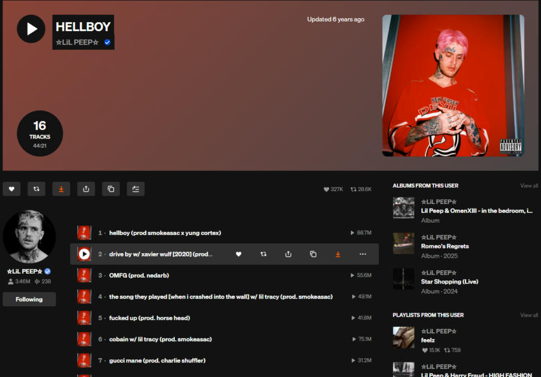
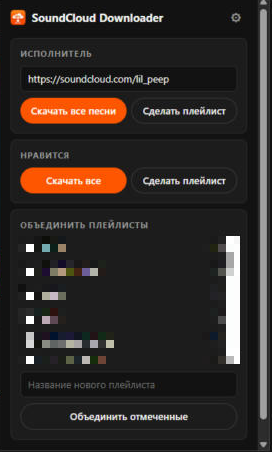

# SoundCloud Downloader

Расширение для Chrome, которое скачивает треки, плейлисты, миксы и лайки SoundCloud в **mp3** с тегами и обложкой.

**[⬇ Скачать последнюю версию](https://github.com/pathetic-mortal/soundcloud-downloader/releases/latest)** · [Установка](#установка) · [Возможности](#возможности) · [Вопросы и ошибки](https://github.com/pathetic-mortal/soundcloud-downloader/issues)



## Установка

1. Откройте страницу **[последнего релиза](https://github.com/pathetic-mortal/soundcloud-downloader/releases/latest)** и скачайте архив `soundcloud-downloader-*.zip` из раздела **Assets**.
2. Распакуйте архив в любую папку, где он будет лежать постоянно (Chrome загружает расширение из неё при каждом запуске).
3. Откройте в Chrome адрес `chrome://extensions`, включите **«Режим разработчика»** (переключатель справа вверху), нажмите **«Загрузить распакованное»** и выберите распакованную папку `soundcloud-downloader`.

Готово: на треках SoundCloud появятся оранжевые кнопки ⬇, а на панели Chrome — иконка с меню. Больше ничего устанавливать не нужно.

**Обновление:** скачайте новый архив из [релизов](https://github.com/pathetic-mortal/soundcloud-downloader/releases), замените им файлы в той же папке и нажмите ↻ у расширения в `chrome://extensions`.

Работает в Chrome 127 и новее, а также в других браузерах на Chromium (Edge, Opera, Яндекс Браузер), где можно загрузить распакованное расширение.

## Возможности

- **Кнопка ⬇ у каждого трека:** на странице трека, плейлиста и микса, в списках, плитках с обложками, очереди и плеере.
- **Только mp3.** Если у трека нет mp3-потока, звук перекодируется в mp3 (256 kbps) прямо в браузере.
- **Теги и обложка:** название, исполнитель, альбом, номер трека, год, жанр, лейбл, ISRC, описание, ссылка и обложка 500×500. «Исполнитель - Песня» в названии разбирается на исполнителя и название.
- **Плейлисты и миксы** скачиваются в папку с их названием, треки нумеруются по порядку.
- **Меню по клику на иконку:**
  - скачать все песни исполнителя или все свои лайки;
  - сделать плейлист из песен исполнителя или из лайков;
  - объединить несколько своих или лайкнутых плейлистов в один;
  - прогресс загрузки с паузой и остановкой — меню само открывается на время загрузки;
  - выбор папки для сохранения (⚙).



Треки с DRM и треки только для подписчиков Go+ не скачиваются.

## Важно

Скачивайте только то, на что у вас есть права: свои треки или треки, которые автор разрешил скачивать. Использование может нарушать [правила SoundCloud](https://soundcloud.com/terms-of-use).

## Для разработчиков

Расширение не требует сборки: папка репозитория — это и есть расширение. Тесты:

```bash
node id3.test.js
node meta.test.js
node shared.test.js
```

## Лицензия

Код расширения — [MIT](LICENSE). Входящий в комплект mp3-энкодер [LAME](http://lame.sourceforge.net) ([lamejs](https://github.com/zhuker/lamejs), `lame.min.js`) распространяется без изменений под собственной лицензией LGPL, подробности в [THIRD_PARTY.md](THIRD_PARTY.md).
